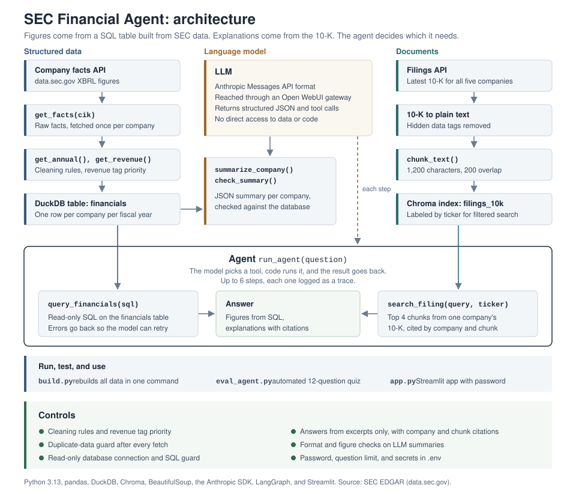

# SEC Financial Agent

An AI research assistant that answers questions about public companies using official SEC data. Financial figures come from a cleaned SQL table built from the SEC's XBRL data. Explanations come from the company's 10-K, retrieved and cited by passage. An agent decides which source each question needs.



## What it can answer

| Question | How the agent answers it |
|---|---|
| "Which company had the highest operating margin in fiscal 2024?" | Writes and runs a SQL query on the financials table |
| "What does Oracle describe as its main business risks?" | Searches Oracle's 10-K and cites the passages it used |
| "How did Oracle's operating margin change last year, and what drove it?" | Pulls the figures with SQL, finds the explanation in the 10-K, and combines them |
| "What was Workday's revenue in fiscal 2024?" | States that Workday is outside its data instead of guessing |

Each answer comes with a trace showing which tools the agent used and with what inputs.

## Design principles

**Figures come from code, not the model.** Every number is pulled from a database built with documented cleaning rules. The language model explains figures; it does not produce them.

**Model output is checked against the source.** Structured summaries are validated against the database, filing answers cite the passages they draw on, and the agent states when its tools do not provide an answer.

**Safe by default.** The agent can only run single read-only SQL queries, its loop is capped at six steps, and credentials never leave the local `.env` file.

## Coverage

Five enterprise software companies (Oracle, Microsoft, Salesforce, Adobe, and ServiceNow), with annual revenue, operating income, net income, and operating margin from each company's XBRL history. Document search covers Oracle's most recent 10-K.

## How it works

**1. Structured data.** Each company's XBRL facts are pulled from the SEC's company facts API and cleaned with four rules: annual 10-K figures only, full-year periods only, the latest filing for each period (which captures restatements), and a priority mapping across the three tags companies have used for revenue. The result is a DuckDB table with one row per company per fiscal year.

**2. SQL analysis and summaries.** Window functions compute year-over-year growth. An LLM produces a structured JSON summary for each company, which is checked against the database before it is saved.

**3. Document retrieval (RAG).** Oracle's latest 10-K is downloaded from EDGAR, converted to text, split into overlapping chunks, and indexed in Chroma with a local embedding model. Questions retrieve the closest chunks, and the model answers from those chunks only, citing them by number.

**4. Agent.** The model receives two tools, `query_financials` (SQL) and `search_filing` (10-K search). It decides which to call, the code runs them, and the results go back until the model has what it needs to answer.

Full details, including every function, the cleaning rules, and the validation log, are in [docs/FUNCTIONS.md](docs/FUNCTIONS.md).

## Tech stack

| Area | Tools |
|---|---|
| Language | Python 3.13 |
| Data | pandas, DuckDB (SQL, window functions) |
| SEC data | EDGAR company facts and submissions APIs, BeautifulSoup |
| Retrieval | Chroma, local embedding model |
| LLM | Anthropic Python SDK (Messages API format, tool use, structured JSON), via an Open WebUI gateway |
| Workflow | Jupyter in VS Code, Git, GitHub |

## Repository structure

```
sec-financial-agent/
├── docs/
│   ├── FUNCTIONS.md       # function reference, controls, validation log
│   └── pipeline.svg       # architecture diagram
├── notebooks/
│   └── 01_edgar_api.ipynb # the full pipeline, step by step
├── src/                   # planned: modules for the app
├── data/                  # generated locally, not committed
├── .env                   # credentials, not committed
├── .gitignore
├── requirements.txt
└── README.md
```

## Running it locally

Clone the repository and set up a virtual environment:

```bash
git clone https://github.com/Shaun8971/sec-financial-agent.git
cd sec-financial-agent
python3.13 -m venv .venv
source .venv/bin/activate
pip install -r requirements.txt
```

Create a `.env` file in the project folder:

```
SEC_USER_AGENT="Shaunak Dhekane you@example.com"
OPENWEBUI_API_KEY="your-key"
OPENWEBUI_BASE_URL="https://chat.dartmouth.edu/api"
```

The SEC requires a name and email with every request. The LLM settings point to any endpoint that accepts the Anthropic Messages API format.

Then open `notebooks/01_edgar_api.ipynb`, select the `.venv` kernel, and run all cells. The first run downloads the SEC data and the embedding model, so it takes a few minutes.

## Limitations

Fiscal years end in different months by company, so figures labeled with the same year can cover different periods. The pipeline covers US GAAP filers and income statement items only. Retrieval uses character-based chunks and meaning-based search without re-ranking, and its quality has not yet been measured. The LLM currently assigns trend labels that could be computed by rules. Each of these is documented in detail, with a planned fix, in [docs/FUNCTIONS.md](docs/FUNCTIONS.md#known-limitations).

## Roadmap

The next steps are a LangGraph version of the agent for comparison, moving the notebook code into `src/` modules, an evaluation suite measuring answer accuracy and retrieval hit rate (including a before-and-after test of section-based chunking), and a deployed Streamlit app with access control and per-query cost tracking.

## Data source

All data comes from SEC EDGAR (data.sec.gov and sec.gov), accessed in line with the SEC's fair access policy. This project is for research and learning, not investment advice.

## Author

Shaunak Dhekane, Master of Engineering Management, Thayer School of Engineering at Dartmouth
